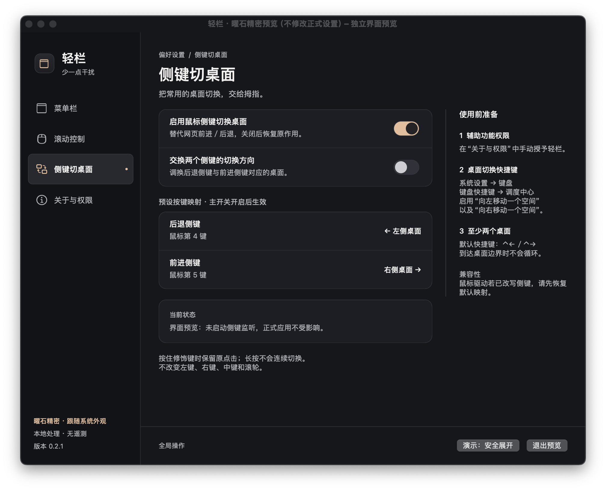
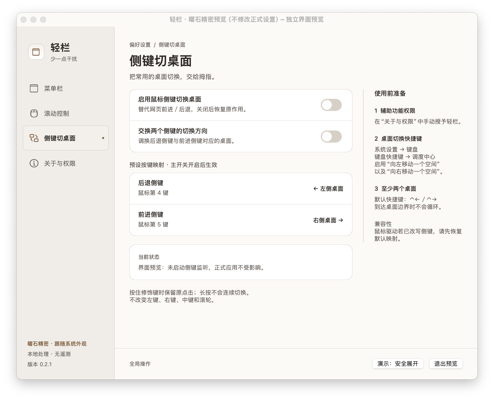

# 轻栏（BarFlow）

一个本地运行的 macOS 原生工具：收起菜单栏图标、单独反转普通鼠标滚轮、用鼠标侧键切换桌面。

**最新版本：v0.2.3 · build 8** ｜ macOS 13.5 及以上 ｜ Apple Silicon（arm64）

[下载安装](https://github.com/bai015857-bot/BarFlow/releases/tag/v0.2.3) · [使用说明](使用说明.md) · [测试范围](TEST_RESULTS.md) · [更新记录](CHANGELOG.md)

## 功能

- **菜单栏管理**：分隔符折叠、展开后自动收起、可启用的全局快捷键 `⌥⌘B`，以及安全展开与退出恢复。
- **鼠标滚动方向**：反转普通鼠标的非连续滚轮，可分别选择纵向、横向；触控板、Magic Mouse 等连续滚动来源保持系统方向，不改写 macOS 的自然滚动设置。
- **侧键切桌面**：常见鼠标第 4／5 键分别切换左右桌面，可交换方向；启用后替代这两个键原来的前进／后退功能，默认关闭。
- **原生中文设置**：“曜石精密”AppKit 界面，含菜单栏、滚动控制、侧键切桌面、关于与权限四页；默认跟随系统浅色／深色外观。
- **本地处理**：无需账户或网络，无云服务、遥测及自动更新请求。

### 界面预览

以下为**原生独立预览演示截图**，用于展示界面，不代表下载后的权限或运行状态；截图来自早期界面预览，版本文字不是当前发布版本。





## 下载安装

1. 打开 [v0.2.3 发布页](https://github.com/bai015857-bot/BarFlow/releases/tag/v0.2.3)，下载 `.dmg` 安装包，或下载应用 ZIP 并解压。`source.zip` 是源码包。预编译二进制仅支持 **Apple Silicon / arm64**，不提供 Intel 版本。
2. 将 `BarFlow.app` 放入固定位置，例如 `/Applications/BarFlow.app`，再打开。后续更新也使用同一位置，避免给下载目录或构建目录中的副本授权。
3. 当前应用使用临时 **ad-hoc 签名，未经苹果公证**，不保证其他电脑可以直接双击打开。如果系统拦截，可尝试 Finder 中右键“打开”，或按系统提示在“系统设置 → 隐私与安全性”中允许打开；实际选项由系统版本和策略决定。也可以审阅源码后自行构建。请勿为安装本软件关闭系统安全保护。

首次启动时，菜单栏折叠、滚动控制、侧键切桌面三项总开关均关闭；登录启动也不会替下载用户自动开启。升级会保留已有偏好。

## 快速使用

- **菜单栏图标**：左键直接展开／收起；右键选择“打开设置…”，也可安全展开、暂停功能或退出。找不到图标时可再次打开 `BarFlow.app` 呼出设置。
- **菜单栏**：先手动暂停其他菜单栏管理工具。启用后按住 `⌘` 拖动分隔符，将待隐藏图标放在左侧，轻栏恢复入口留在右侧、同一屏幕，再测试展开／收起。
- **滚动**：先手动退出 Scroll Reverser。开启“启用滚动方向控制”“反转鼠标”“反转纵向”；推荐系统自然滚动保持开启。“反转”是相对于系统当前方向翻转，而非强制绝对方向。
- **侧键**：先在调度中心准备至少两个桌面，确认系统“向左／向右移动一个空间”快捷键已启用，再开启侧键功能。默认快捷键为 `⌃←`／`⌃→`，到边界不循环。
- **登录启动**：可在应用内使用 ServiceManagement 注册，或在系统“通用 → 登录项”中添加固定位置的应用。两种入口的状态不一定一致，应用内开关不代表手动添加项的完整状态。

详见[使用说明](使用说明.md)，包含权限、登录项、恢复和卸载步骤。

## 从源码构建

需要 macOS、Xcode Command Line Tools 与 Swift 6.1 工具链；代码使用 Swift 5 语言模式，无需完整 Xcode。

在源码根目录运行：

```sh
bash scripts/build.sh
```

产物为 `dist/BarFlow.app`。构建不等于获得 Developer ID 签名或苹果公证。

## 测试

```sh
python3 scripts/verify-all.py
```

统一运行设置、启动、UI、菜单栏、滚动、侧键、集成七套测试。已记录的七套结果均退出 0；菜单栏含 149 项断言、滚动 22 项、侧键 23 项。界面包含浅深色、最小／最大尺寸及长状态文本回归。

macOS 15.6.1 / ARM64 环境下，普通物理鼠标滚轮、两个侧键和应用正常退出重开已获用户确认；这不等于跨设备兼容性保证。详见 [TEST_RESULTS.md](TEST_RESULTS.md)。

## 权限与限制

- 菜单栏折叠不需要辅助功能；滚动控制和侧键切桌面需要你在系统设置中手动授权。**不截屏，不申请屏幕录制权限。**
- 临时签名随构建变化，更新后可能需要移除轻栏旧辅助功能条目，重新添加固定位置的新版本；不要清空所有应用的权限。
- 为保持升级和已存设置兼容，沿用应用标识 `local.longkaixin.barflow`；源码与安装包中可见该标识。发布不包含个人设置、本机路径或授权日志。
- Scroll Reverser 进程仍在运行时，即使其界面已暂停，轻栏也会保守拒绝启动滚动控制。轻栏不会主动退出、卸载或改写其他软件。
- 本版不提供触控板独立反转，不承诺精确识别每种连续滚动设备；没有截图聚合面板。
- 鼠标驱动若把侧键转换成键盘事件，轻栏可能收不到原始侧键。系统空间快捷键只读，不会被轻栏自动改写。
- 尚未全面覆盖多屏、全屏及第三方驱动；未完成完整 VoiceOver 人工验收、实际注销重登测试，也不保证未公证应用在其他电脑上的首次打开体验。

## 许可证与致谢

轻栏的原创源码采用 [MIT 许可证](LICENSE)。菜单栏与界面模块独立编写，不包含其他商业软件的二进制或版权资源。

滚动处理参考 Nick Moore / Pilotmoon Software 的 [Scroll Reverser](https://github.com/pilotmoon/Scroll-Reverser)。相关第三方内容保留 **Apache-2.0** 许可、归属和声明，不因项目原创部分采用 MIT 而改为 MIT。详见 [THIRD_PARTY_NOTICES.md](THIRD_PARTY_NOTICES.md) 与 [保留的第三方许可证](vendor-notices/Scroll-Reverser-LICENSE.txt)。
